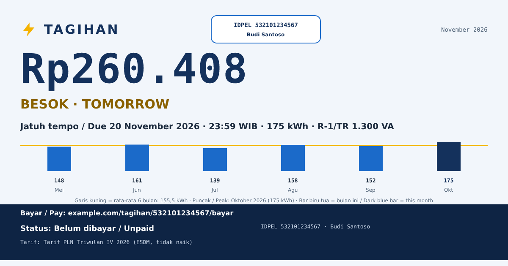

# TAGIHAN — PLN Electricity Bill Kit

One meter reading, five outputs, zero discrepancy: a monthly electricity
bill kit for a PLN postpaid household, built with **Hyper Elements**
(`@hyper-elements/react`) for the **Unlayer Hyper Elements Template
Challenge** ($500 prize pool, 5 winners × $100, judged on originality,
design quality, practical value, effective Hyper Elements use, and
execution).

## What it is

**TAGIHAN** turns a single meter reading into everything a customer needs
for their monthly electricity bill:

1. **Bill email** — the bill a customer opens on their phone: the total,
   the meter readings, the breakdown, the due date with its countdown, the
   pay action and the payment status, the 6-month usage history
   (`src/BillEmail.tsx` → `BillEmail.html` + `.txt`).
2. **Payment receipt email** — the proof of payment for the previous bill:
   the amount, the reference number, the paid date, the channel, the
   breakdown of what was paid, and the next bill
   (`src/ReceiptEmail.tsx` → `ReceiptEmail.html` + `.txt`).
3. **Usage page** — the dashboard for the bill: the total, the countdown,
   the 6-month usage bar chart, the payment block, the full breakdown, the
   PLN household tariff table and the status legend
   (`src/UsagePage.tsx` → `UsagePage.html`).
4. **Bill PDF (A4, 2 pages)** — the printable bill: the meter readings,
   the payment block, the breakdown, how to pay, the usage history, the
   tariff table and the proof strip (`src/BillPdf.tsx` → `BillPdf.pdf`).
5. **Reminder card (1200 × 630)** — the share image for WhatsApp and
   social media: the total in giant type, "BESOK / TOMORROW", the due
   date, the 6-month usage chart, the pay link and the status
   (`src/ReminderCard.tsx` → `ReminderCard.png`).

The sharp idea is **"one meter reading, one bill"**: every output carries
the same IDPEL (`532101234567`), built from the customer record. In a
monthly bill, the most dangerous failure is not a late payment — it is
two reminders that disagree about how much is owed. The kit makes
disagreement impossible by construction: all five outputs are rendered
from **one data file** (`src/data.ts`) and **one theme** (`src/theme.ts`),
and every derived value — the kWh used, the energy charge, the PPJ, the
total, the comparison with last month, the countdown ("tomorrow", "in X
days"), the payment reference — is **computed by code** from the meter
reading and the tariff, never typed in per output. Change the meter
reading and every kWh, every charge and every countdown changes with it.

Seven things no other entry in the challenge does:

- **Two languages** — every label is Indonesian + English from the same
  data, so the two versions can never drift apart.
- **Computed money** — the bill is arithmetic on the meter reading
  (kWh × the flat PLN tariff + PPJ), not typed-in numbers.
- **Real rules** — the tariff is the real ESDM Q4 2026 PLN tariff, and
  the due date is the real PLN postpaid due date (the 20th).
- **A payment countdown** — "due tomorrow" is derived from the due date
  and the reference date, never typed in.
- **A recipient response loop** — the bill carries a "Pay now" action
  (Button / Link to the payment URL for this IDPEL) and a payment status
  as a data field, so the payment side can tell a paid bill from a
  waiting one — on every output.
- **A human story** — one family's monthly electricity bill, not an
  administrative form.
- **Proof** — one IDPEL on all five outputs, so a printed bill can be
  matched to the email and the page without doubt.

## Screenshots



*The reminder card (`output/src/ReminderCard.png`, 1200 × 630): the total,
the countdown, the due date, the 6-month usage chart, the pay link and
status, and the IDPEL that ties it to the bill email, the receipt, the
page and the bill PDF. (A full-page screenshot of the usage page could
not be rendered on this machine — headless Chromium is blocked here — so
the README ships the card as the visual; the usage page itself is
verified by `npm run check` and by content checks below.)*

## How Hyper Elements is used

The kit is written entirely as Hyper Elements components — no hand-written
HTML, no raw `<style>`, no image assets at all (every visual is drawn in
code: SVG usage bars, an SVG lightning bolt, colour). The five roots share
one data file, one theme and one set of shared components (`src/shared.tsx`).

| Component | Where / how it is used |
| --- | --- |
| `Email` | Root of the bill email AND of the payment receipt email — two Email roots in one project, both from the same data. `width={600}`, `previewText`, `title`, `lang="id"`, `theme={tagihanTheme}`. A navy masthead band with the customer badge, the total hero, the meter readings, the payment block, the breakdown table, the usage bars and the proof strip with the pay button. `MergeTag name="first_name"` personalises the greeting; the CLI also emits the plain-text version. The receipt's masthead band is green, so "paid" reads at a glance. |
| `Page` | Root of the usage dashboard. `width={1120}`, hero band with the total, the due date and the usage in giant figures, `Grid columns={2}` for chart + payment and for tariff + legend, the full breakdown table, and the proof strip. |
| `Document` | Root of the printable bill. `size="A4"`, `orientation="portrait"`, two `Document.Page`s: page 1 (the meter readings, the payment block, the breakdown) and page 2 (how to pay, the usage history, the tariff table, the proof strip). `PageNumber` / `PageNumber total` in the footers; DejaVu fonts registered for the PDF renderer. The pay action has no button here — a PDF has no hover — so the bill prints the payment URL as text instead. |
| `Canvas` | Root of the reminder card. `width={1200} height={630}`: giant total, the countdown, the due line, an SVG bar chart of the last 6 months with an average line, an SVG lightning bolt, and a dark navy band with the pay link and the status. |
| `defineTheme` + `token()` | `src/theme.ts`: the brand written once — the utility palette (deep navy, electric yellow, light blue-grey), body/heading fonts, Heading type scale, Button defaults, and a named `card` style applied with `style={{ apply: ["card"] }}`. `token("colors.muted")` / `token("colors.border")` resolve theme tokens inside the templates. The muted text was darkened until it passes 4.5:1 body-text contrast on white. |
| `Svg` / `Rect` / `Line` / `Path` | The 6-month usage chart (`UsageBarsSvg` in `src/shared.tsx`): one bar per month coloured by recency, a yellow line for the 6-month average; the lightning bolt on the reminder card. |
| `Table` / `TableRow` / `TableCell` | The bill breakdown (rincian / calculation / amount) on the bill email, the receipt, the page and the bill PDF; the full tariff table on the page and on page 2 of the bill. |
| `Row` / `Column` / `Grid` | All layout. `Grid columns={2}` for chart + payment and for tariff + legend on the page. |
| `Heading` | One `level={1}` per template; `level={2}` section titles, `level={3}` kickers. |
| `Text` / `Span` / `Divider` / `Button` / `Link` | Body copy, bilingual label pairs (`Bi` in `src/shared.tsx`), monospace figures (`fontFamily`), tracked-out uppercase kickers (`letterSpacing` + `textTransform`), section dividers, the "Bayar Sekarang / Pay Now" button (both emails + page) and the "Cek tagihan / Check bill" link. |
| `render()` / `renderPdf` / `renderImage` via the CLI, with the `@hyper-elements/email-clients` plugin | Validation is a build gate, and the checks caught real issues that were fixed in the code (a `Text` inside a `TableCell` the validator rejects, a missing `Span` import, content overflowing the A4 pages). |

## The data — real, and computed, not typed

The tariff and the scenario come from the real Indonesian electricity
rules:

- **ESDM (Ministry of Energy and Mineral Resources), Q4 2026
  (Oct–Dec 2026)** — the PLN household tariff, UNCHANGED from Q3 2026.
  Household rates are **flat per kWh within a power class** — the same
  rate applies to every kWh, so the energy charge is simply usage × rate.
  There are NO tiered usage blocks for households; the kit says so
  explicitly on every output that shows the tariff:
  R-1/TR 450 VA subsidised Rp415; R-1/TR 900 VA subsidised Rp605; R-1/TR
  900 VA RTM Rp1.352; R-1/TR 1.300 VA Rp1.444,70; R-1/TR 2.200 VA
  Rp1.444,70; R-2/TR 3.500–5.500 VA Rp1.699,53; R-3/TR 6.600 VA and above
  Rp1.699,53.
- **PPJ (Pajak Penerangan Jalan / street-lighting tax)** is a percentage
  of the energy charge set by each regional government (perda) — it
  varies by region. This sample uses **3% as a data field**, and every
  output says so; no reader can mistake it for a fixed national rate.
- **Postpaid billing rhythm** — the bill for October usage is issued in
  November and falls due on the 20th, the real PLN postpaid due date.
- **Scenario** — a fictional family, **Budi Santoso, R-1/TR 1.300 VA,
  Kebumen, IDPEL 532101234567, meter 0038123456**, at PLN ULP Kebumen.
  The reference date ("today" in the data) is **Thursday 19 November
  2026**. The November 2026 bill covers October 2026 usage: meter 8.412
  → 8.587 = **175 kWh**. At Rp1.444,70/kWh the energy charge is
  **Rp252.823**; PPJ 3% is **Rp7.585**; the total is **Rp260.408** — due
  **Friday 20 November 2026, tomorrow, in 1 day**. Last month (September
  usage) was 152 kWh, so usage is up 23 kWh (+15,1%). The September bill
  (152 kWh → Rp219.594 + PPJ Rp6.588 = **Rp226.182**) was paid on
  **18 October 2026 via PLN Mobile** (reference `INV-20261018-4567`) —
  that is the receipt email. The meter chain is continuous: August ended
  at 8.260, September ended at 8.412, October ended at 8.587. Every
  output says this is a sample scenario, not a real bill; the customer,
  the IDPEL, the meter readings and the payment record are illustrative,
  while the tariff rules and the bill arithmetic are real.
- **Bill arithmetic** — `src/data.ts` holds the customer, the meter
  readings and the tariff; `usageKwh` subtracts the readings;
  `energyCharge` multiplies by the flat rate and rounds to whole rupiah;
  `ppjAmount` takes the PPJ rate of the energy charge; `totalBill` adds
  them; `billLines` builds the breakdown; `usageChange` compares with
  last month; `countdownLabel` turns the gap to the due date into
  "tomorrow" / "in X days"; `paymentRef` builds the receipt reference
  from the paid date and the IDPEL. Swap the sample meter reading for a
  real one and all five outputs follow.

## Run it

```bash
npm install
npm run typecheck   # tsc --noEmit
npm run check       # hyper-elements check src (0 errors, 0 warnings)
npm run render      # hyper-elements render src --out output
```

Outputs land in `output/src/`:

| File | What it is |
| --- | --- |
| `BillEmail.html` (+ `.txt`) | The November bill email, HTML + plain text |
| `ReceiptEmail.html` (+ `.txt`) | The October payment receipt email, HTML + plain text |
| `UsagePage.html` | The usage dashboard page |
| `BillPdf.pdf` | The printable A4 bill (2 pages) |
| `ReminderCard.png` | The 1200 × 630 payment reminder card |

Fonts: DejaVu Sans / DejaVu Sans Mono (regular + bold) live in
`assets/fonts/` and are registered for the PDF and image renderers
(`PRINT_FONTS` in `src/theme.ts`); the emails and page use the system
font stack from the theme. The Canvas and Document roots need their
renderers installed (`satori`, `@resvg/resvg-js`,
`@react-pdf/renderer` — already in `package.json`).

## Notes for the judges

- **Originality** — no other entry in the challenge covers a utility
  bill, and none has five outputs from one data file: two different
  emails (bill + receipt) from the same customer record is the kit's
  answer to the multi-output pattern the strongest entries use. The
  computed money, the payment countdown and the pay-now response loop
  are things no other entry has.
- **Design** — deep navy and electric yellow, deliberately different
  from an emergency system and from a baby's first year: a utility bill
  that reads at a glance. The status colour *is* the information: amber
  unpaid, green paid, red overdue.
- **Practical value** — a real workflow a utility or a payment app could
  actually run: one meter reading in, five ready-to-send outputs out;
  real tariff rules, a real due-date rhythm, a printable bill, a
  shareable reminder.
- **Hyper Elements use** — all four root types from one codebase, two of
  them Email roots, plus SVG charts, theme tokens, and the `PageNumber` /
  font registration the Document and Canvas roots need.
- **Execution** — `npm run check` is 0 errors, 0 warnings;
  `npm run render` produces all five outputs; every output was verified
  (reminder card and both PDF pages read as images; both plain-text
  emails read in full; the page and email HTML content-checked for the
  IDPEL, the totals, the countdown and the bilingual labels).
  Verification caught real issues — the "How to pay" section and the page
  footers were clipped off the A4 pages because the Document renderer
  drops overflowing content instead of flowing it — and they were fixed
  by restructuring the pages (the section moved, the legend dropped from
  the PDF, chart labels shortened), not by shrinking the font.
